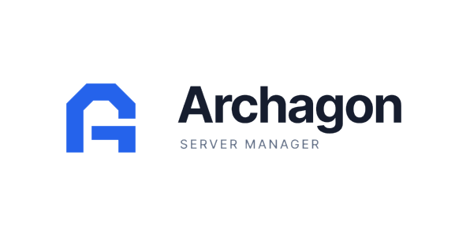

<p align="center">
  <picture>
    <source media="(prefers-color-scheme: dark)" srcset="src/assets/archagon-logo-dark.png">
    
  </picture>
</p>

# Archagon

Archagon is a Laragon-inspired desktop server manager for Arch Linux. It controls the native `httpd` and `mariadb` services already installed on your system. Archagon **does not install Apache or MariaDB**.

## Why I built Archagon

My campus asked me to use Laragon, but I use Linux. I wasn't very familiar with XAMPP's commands, and its GUI felt very outdated to me. I wanted a server manager that felt more at home on my system, so I built Archagon for Arch Linux.

## Tech stack
- Tauri 2 + Rust
- Vite + HTML/CSS/JavaScript
- Native systemd and Polkit (`pkexec`)

## Features

- Start All / Stop All via `pkexec systemctl`
- Real-time service status, polled every 2.5 seconds
- Quick actions for localhost, phpMyAdmin, a terminal in `/srv/http`, and the file manager
- Open Apache, PHP, and MariaDB configuration files
- Light/dark mode
- Simple Auto Virtual Hosts for project directories directly inside `/srv/http`

## Arch Linux prerequisites

Make sure the following packages are installed:

```bash
sudo pacman -S --needed base-devel curl wget file git nodejs npm rustup   webkit2gtk-4.1 gtk3 libayatana-appindicator librsvg   openssl pkgconf patchelf
rustup default stable
```

For GUI actions:
```bash
sudo pacman -S --needed polkit xdg-utils
```

The target system is expected to already have `httpd`, `mariadb`, PHP, and phpMyAdmin installed.

## Run in development mode

```bash
unzip archagon.zip
cd archagon
npm install
npm run tauri dev
```

## Build the application

```bash
npm run tauri build
```

> **Important:** Always build with the Tauri CLI (`npm run tauri build`). A plain
> `cargo build --release` does not enable the `custom-protocol` feature, so the
> resulting binary runs in dev mode and shows
> `Could not connect to 127.0.0.1: Connection refused` instead of the UI.

The built packages are located in:
`src-tauri/target/release/bundle/`

## Polkit / pkexec

**Do not run Archagon as root.** The service buttons call the `pkexec` executable with the fixed `/usr/bin/systemctl` argument. The desktop's Polkit agent displays the authentication prompt. If the prompt does not appear, make sure your desktop session is running a Polkit authentication agent.

## Auto Virtual Hosts

Auto VHosts is disabled by default. To use it:

1. Make sure Apache is running.
2. Add the following line to `/etc/httpd/conf/httpd.conf` once:

   ```apache
   IncludeOptional conf/extra/archagon-vhosts.conf
   ```

3. Create a project directory directly inside `/srv/http`, for example `/srv/http/demo`.
4. Enable Auto Virtual Hosts in the UI. The app scans the directory every 8 seconds, writes the configuration to `/etc/httpd/conf/extra/archagon-vhosts.conf`, and uses Polkit to add an entry such as `127.0.0.1 demo.test` to `/etc/hosts`.
5. After the initial configuration is created, reload Apache:

   ```bash
   sudo systemctl reload httpd
   ```

   Reload Apache if needed after later virtual host changes.

Directory names are limited to lowercase letters, numbers, and hyphens to avoid invalid hostnames. Entries are not automatically removed from the hosts file when a project directory is deleted. Manually remove the corresponding line, such as `127.0.0.1 demo.test`, when it is no longer needed.

**Note:** This feature only processes project directories at the top level of `/srv/http`. Make sure the web directory contains only projects you intend to serve through Apache.

## Configuration files
- Apache: `/etc/httpd/conf/httpd.conf`
- PHP: `/etc/php/php.ini`
- MariaDB: `/etc/my.cnf`

If your system stores the MariaDB configuration elsewhere, update the constant in `src-tauri/src/system.rs`.

## Security notes
- Backend commands use an allowlist for the `httpd` and `mariadb` services.
- UI input is not used to construct shell commands for starting or stopping services.
- Operations that require administrative privileges use Polkit. The app does not request root privileges at startup.
- Virtual hosts only accept directory names that pass character validation.

## License

Archagon is licensed under the MIT License. See the [LICENSE](LICENSE) file.
